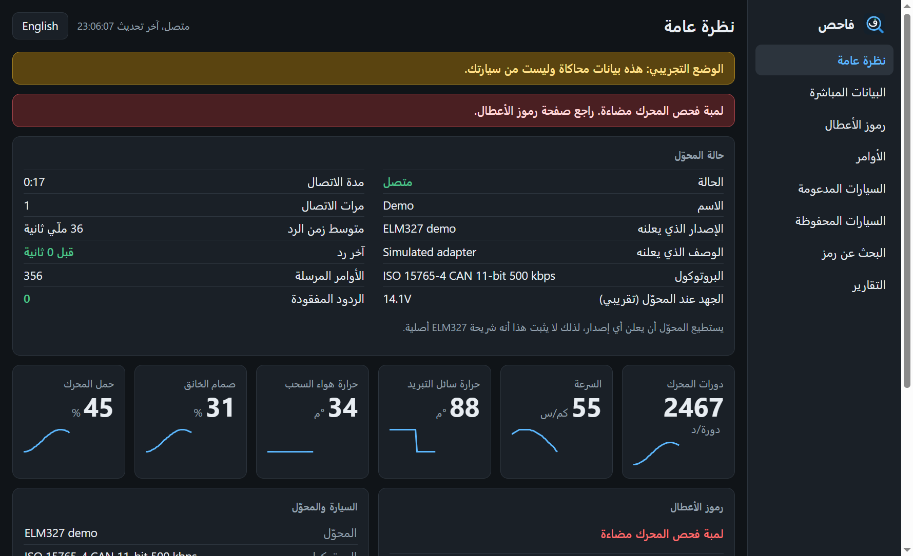
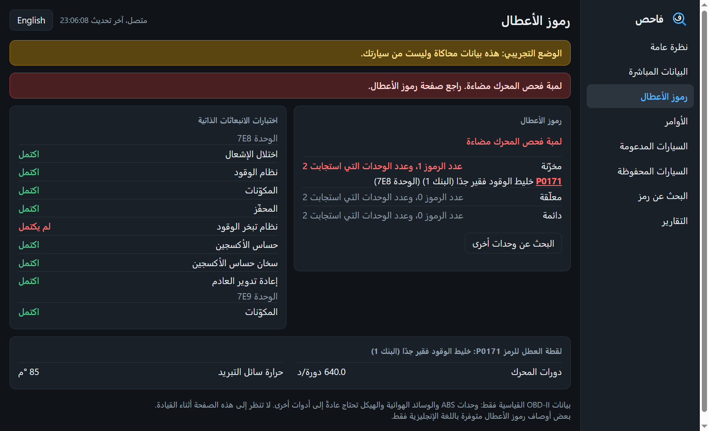
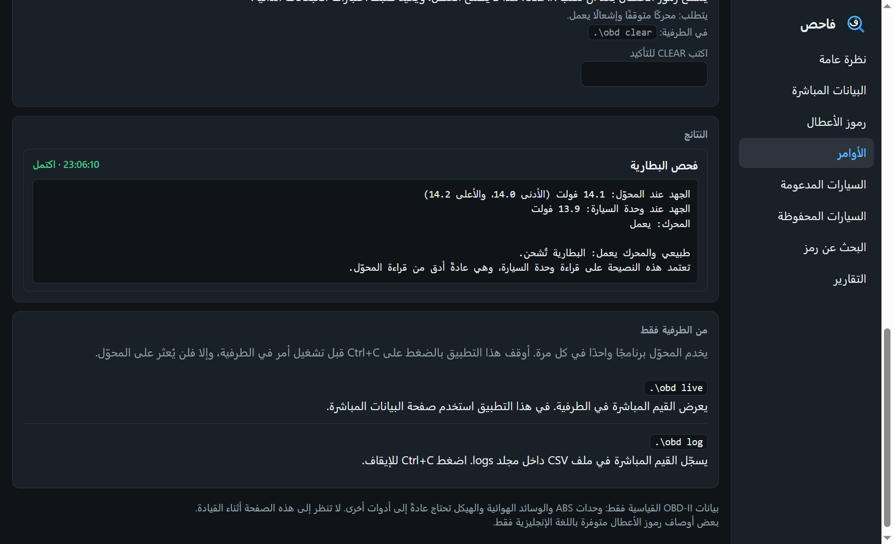
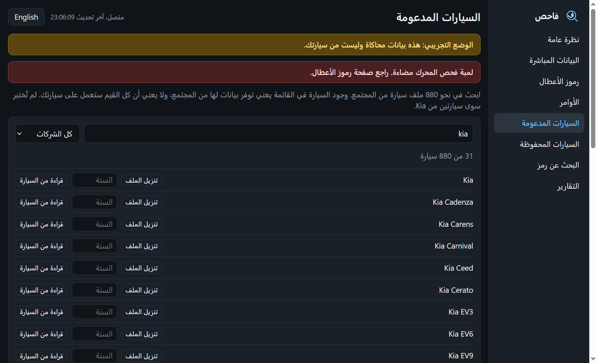
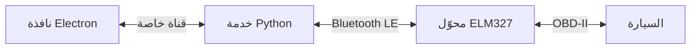
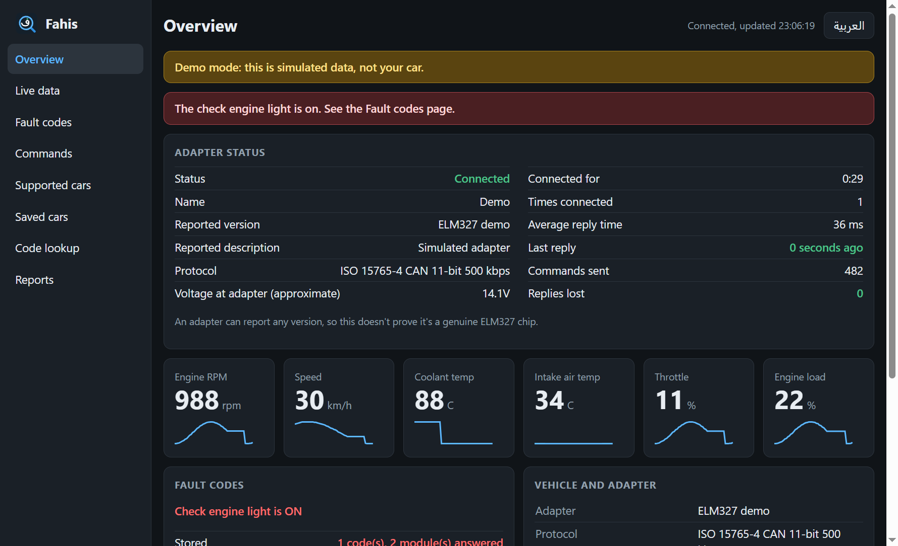
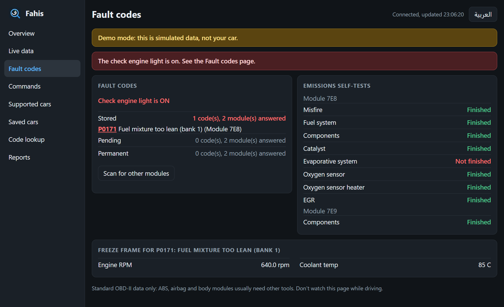
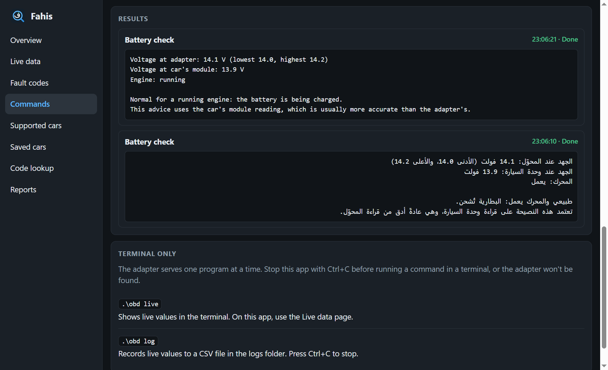
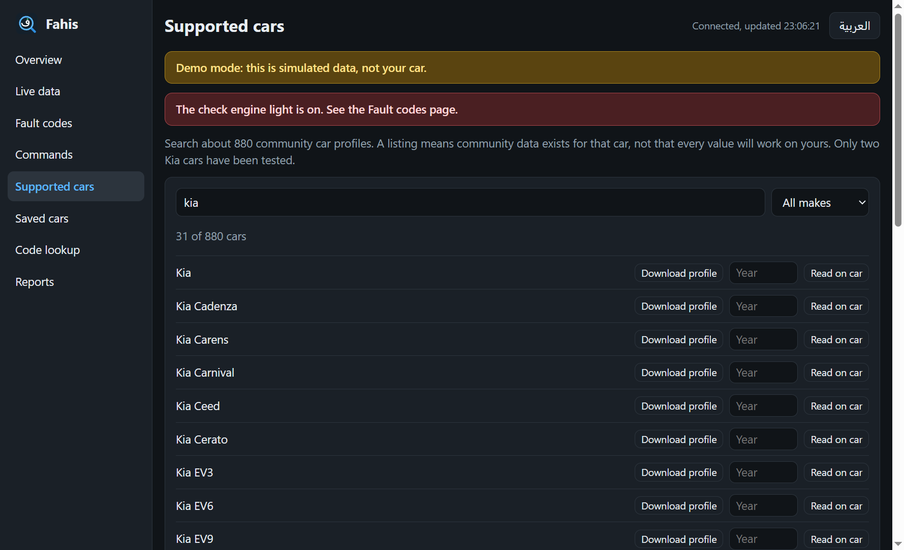
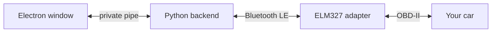

<div dir="rtl" align="center">

<picture>
  <source media="(prefers-color-scheme: dark)" srcset="docs/opening-dark.png">
  <source media="(prefers-color-scheme: light)" srcset="docs/opening-light.png">
  
</picture>

<br>


<h2>فاحص · Fahis</h2>

**اعرف ما تقوله سيارتك، من حاسوبك وبمحوّل ELM327 رخيص.**

*See what your car is reporting, on your laptop, with a cheap ELM327 adapter.*

<br>


[](LICENSE)

<br>

### [العربية](#العربية) &nbsp;·&nbsp; [English](#english)

</div>

---

<div dir="rtl" lang="ar">

## العربية

كثير من محوّلات ELM327 تعمل بتقنية Bluetooth LE، ولا يعطيها Windows منفذ COM، لذلك لا تجدها معظم برامج OBD-II. أما **فاحص** فيتصل بالمحوّل مباشرة، ويعرض بيانات سيارتك في تطبيق سطح مكتب بالعربية والإنجليزية.

<table>
<tr>
<td width="50%"><p align="center"><b>نظرة عامة</b></p></td>
<td width="50%"><p align="center"><b>رموز الأعطال</b></p></td>
</tr>
<tr>
<td width="50%"><p align="center"><b>الأوامر والنتائج</b></p></td>
<td width="50%"><p align="center"><b>السيارات المدعومة</b></p></td>
</tr>
</table>

<p align="center"><i>الصور من الوضع التجريبي، فالبيانات المعروضة محاكاة.</i></p>

### المزايا

<table>
<tr>
<td width="50%" valign="top"><b>تطبيق سطح مكتب</b><br>سبع صفحات: نظرة عامة مع حالة المحوّل، وبيانات مباشرة، ورموز أعطال، وأوامر، وسيارات مدعومة، وسيارات محفوظة، وتقارير.</td>
<td width="50%" valign="top"><b>الأوامر داخل التطبيق</b><br>شغّل فحص البطارية والتقرير والبحث عن الوحدات وغيرها، واقرأ النتيجة في الصفحة نفسها.</td>
</tr>
<tr>
<td valign="top"><b>رموز الأعطال</b><br>المخزّنة والمعلّقة والدائمة، مع أوصاف لنحو 9,500 رمز عام.</td>
<td valign="top"><b>سيارات كثيرة</b><br>قائمة قابلة للبحث تضم نحو 880 ملف سيارة من المجتمع، وتُنزَّل عند الحاجة.</td>
</tr>
<tr>
<td valign="top"><b>العربية والإنجليزية</b><br>زر واحد يبدّل اللغة ويحوّل التطبيق من اليمين إلى اليسار.</td>
<td valign="top"><b>حفظ السيارات</b><br>يحفظ كل سيارة تتصل به مع بياناتها وآخر قراءاتها، على جهازك فقط.</td>
</tr>
<tr>
<td valign="top"><b>فحص البطارية</b><br>يشرح الجهد بلغة بسيطة، ويعتمد على قراءة السيارة نفسها إذا توفرت.</td>
<td valign="top"><b>مسح محميّ</b><br>لا يعمل مسح الرموز إلا والمحرك متوقف، وبعد أن تكتب <code>CLEAR</code>.</td>
</tr>
<tr>
<td valign="top"><b>البحث عن رمز</b><br>الأسباب الشائعة والأعراض لأي رمز عام، دون الحاجة إلى سيارة. التفاصيل بالإنجليزية.</td>
<td valign="top"><b>رسوم بيانية</b><br>تابع حتى أربع قيم مباشرة في رسوم بيانية داخل التطبيق.</td>
</tr>
<tr>
<td valign="top"><b>التسجيل وملخص الرحلة</b><br>ابدأ التسجيل وأوقفه من التطبيق، واحصل على ملف CSV وملخص للرحلة.</td>
<td valign="top"><b>تنبيهات</b><br>تحذيرات من ارتفاع الحرارة ومشكلات الشحن وانخفاض البطارية ولمبة فحص المحرك.</td>
</tr>
</table>

### البدء السريع

**المتطلبات:** نظام Windows 10 أو 11 مع Bluetooth، و‏Python 3.12، و‏Node.js، ومحوّل ELM327 يعمل بتقنية BLE ويوفر الخدمة `FFF0`، وسيارة تستخدم CAN بعناوين 11 بت.

<div dir="ltr">

```
git clone https://github.com/alequab/Fahis.git
cd Fahis
python -m venv .venv
.venv\Scripts\python -m pip install -r requirements.txt
npm install
npm run setup
npm start
```

</div>

لتجربته دون سيارة ببيانات محاكاة، شغّل `npm run demo`.

**للاتصال بالسيارة:**

1. وصّل المحوّل بمنفذ OBD-II في السيارة.
2. شغّل المحرك في مكان مفتوح، أو أدر مفتاح الإشعال.
3. أقرن المحوّل من إعدادات Bluetooth في Windows. إذا طلب رمز PIN فجرّب `1234` أو `0000` أو `6789`.
4. أوقف Bluetooth في أي هاتف اتصل بالمحوّل من قبل.

يواصل التطبيق البحث عن المحوّل حتى تستجيب السيارة، وعند إغلاق النافذة ينقطع الاتصال بالمحوّل.

### كيف يعمل

<div dir="ltr">



</div>

### السلامة والخصوصية

- **لا تستخدم التطبيق أثناء القيادة.** استخدم `.\obd log`، أو اجعل أحد الركاب يتابعه.
- **انتبه إلى البطارية.** تُستنزف البطارية عندما يكون الإشعال يعمل والمحرك متوقفًا. افصل المحوّل عند الانتهاء.
- **مسح الرموز لا يصلح العطل.** وهو يمحو أيضًا بيانات الأعطال المحفوظة ويعيد ضبط اختبارات الانبعاثات الذاتية.
- **كل الأوامر ما عدا `clear` تقرأ البيانات فقط.**
- **بياناتك على جهازك.** تتصل النافذة بخدمتها الخلفية عبر قناة خاصة دون خادم ويب أو منفذ شبكة مفتوح. وتنزيل ملف سيارة هو المرة الوحيدة التي يتصل فيها التطبيق نفسه بالإنترنت.

### ما يجب معرفته

- اختُبر مع محوّل BLE واحد يعرّف نفسه بأنه `ELM327 v2.1` على سيارتين من Kia، إحداهما بنزين والأخرى ديزل. ومعظم السيارات في القائمة لم تُختبر.
- اختُبرت الأوامر التي تُشغَّل من صفحة الأوامر على سيارة حقيقية واحدة، وهي سيارة البنزين. أما `clear` فلم يُشغَّل على أي سيارة حتى الآن.
- لم تُختبر الرسوم البيانية والتسجيل من التطبيق والتنبيهات والقراءات السابقة والقيم الإضافية حتى الآن إلا في الوضع التجريبي. وحدود التنبيهات إرشادات عامة، وليست حدودًا لسيارة بعينها.
- قد لا تستجيب إحدى الوحدات أحيانًا رغم تكرار الطلب، وعندها يوضّح التطبيق ذلك، فأعد المحاولة قبل أن تعتبرها خالية من الأعطال.
- في السيارتين المختبرتين لم يستجب إلا وحدتا المحرك وناقل الحركة، فلم تُقرأ أعطال ABS والوسائد الهوائية والهيكل. وتختلف النتائج من سيارة إلى أخرى.

<details>
<summary><b>أوامر الطرفية</b></summary>

<br>

أغلق التطبيق قبل تشغيل أمر في الطرفية، لأن المحوّل يخدم برنامجًا واحدًا في كل مرة.

| الأمر | ماذا يفعل |
|---|---|
| `.\obd report` | يقرأ كل البيانات مرة واحدة ويحفظها في مجلد `reports\` |
| `.\obd info` | المحوّل والجهد ولمبة فحص المحرك والاختبارات الذاتية |
| `.\obd battery` | جهد البطارية مع شرح بلغة بسيطة |
| `.\obd codes` | رموز الأعطال المخزّنة والمعلّقة والدائمة |
| `.\obd scan` | يبحث عن وحدات أخرى ويقرأ رموز أعطالها إذا سُمح بذلك |
| `.\obd cars` | يعرض السيارات المحفوظة على هذا الجهاز |
| `.\obd profiles toyota` | يبحث في قائمة ملفات السيارات |
| `.\obd profile --name kia-picanto --year 2017` | يقرأ قيمًا إضافية لسيارتك، وينزّل ملفها عند الحاجة |
| `.\obd live` | القيم المباشرة في الطرفية |
| `.\obd log` | القيم المباشرة مع حفظها بصيغة CSV في مجلد `logs\` |
| `.\obd clear` | يمسح رموز الأعطال بعد أن يطلب منك التأكيد |

**الخيارات**

- ‏`--lang ar` أو `--lang en` يحدد اللغة ويحفظها، ويُكتب قبل الأمر، مثل `.\obd --lang ar report`.
- ‏`--address AA:BB:CC:DD:EE:FF` يختار محوّلًا محددًا، ويُكتب قبل الأمر.
- ‏`--interval 1` يحدد عدد الثواني بين القراءات، و`--samples 20` يوقف البرنامج بعد 20 قراءة، للأمرين `live` و`log`.
- ‏`.\obd profiles --get toyota-camry` ينزّل ملف السيارة الآن لتستخدمه لاحقًا دون إنترنت.

</details>

<details>
<summary><b>كل الحدود</b></summary>

<br>

- يعمل التطبيق من الشيفرة المصدرية دون برنامج تثبيت حتى الآن.
- قيم ملفات السيارات مصدرها بيانات المجتمع، وقد لا تطابق سنة سيارتك بالضبط، وقد لا ينطبق بعضها على سيارتك أصلًا.
- يتخطى `profile` الأوامر التي لا يستطيع إرسالها بأمان أو لا يدعمها: وهي التي تفتح جلسة تشخيص خاصة، والتي تستخدم عناوين 29 بت أو العناوين الموسّعة.
- يدعم CAN بعناوين 11 بت فقط، ولا يدعم المحوّلات التي تعمل بتقنية Bluetooth التقليدية أو USB أو Wi-Fi.
- تغطي أوصاف رموز الأعطال نحو 9,500 رمز عام. أما الرموز الخاصة بالشركات المصنّعة فيظهر تصنيفها فقط.
- في العربية تُرجم نحو 80 رمز عطل شائعًا، وتبقى الرموز الأخرى وأسماء قيم ملفات السيارات بالإنجليزية.
- قد تظهر العربية بشكل سيئ في طرفية Windows. التطبيق وملفات التقارير أفضل لقراءتها.
- قد تكون قراءة الجهد من المحوّل غير دقيقة: ففي الإعداد الذي جرى اختباره كانت أعلى بنحو 1 فولت من قراءة وحدة السيارة.

</details>

<details>
<summary><b>التطوير وملفات المشروع</b></summary>

<br>

شغّل الاختبارات التي لا تحتاج إلى سيارة أو محوّل:

<div dir="ltr">

```
.venv\Scripts\python -m unittest test_obd_tool
```

</div>

| الملف | وظيفته |
|---|---|
| `obd_tool.py` | الاتصال بالمحوّل وتفسير بيانات OBD-II والأوامر |
| `car_modules.py` | البحث عن الوحدات وتفسير ملفات السيارات |
| `garage.py` | سجلات السيارات المحفوظة |
| `i18n.py` | النصوص العربية والإنجليزية |
| `bridge.py` | القناة الخاصة بين النافذة والخدمة الخلفية |
| `electron/` | نافذة سطح المكتب وصفحات التطبيق والأيقونة |
| `demo.py` | محوّل محاكاة للوضع التجريبي |
| `dtc_codes.py` | البحث عن أوصاف رموز الأعطال |
| `profiles\` | قائمة السيارات وملف Kia Picanto، من OBDb |
| `data\` | أوصاف رموز الأعطال العامة، من OBDex |
| `test_obd_tool.py` | الاختبارات |

</details>

### الرخصة

يمكن **للأفراد** استخدام فاحص وتعديله ومشاركته مجانًا للأغراض الشخصية. **ولا يحق للشركات والمؤسسات استخدامه** بدون إذن كتابي، ويشمل ذلك العاملين لحسابهم الخاص والأعمال الفردية عند استخدامه في عملهم. ولا يجوز بيعه. راجع ملف [LICENSE](LICENSE) للاطلاع على الشروط كاملة، والنص الإنجليزي هو المعتمد.

بسبب هذه القيود، يُعد فاحص مشروعًا متاح الشيفرة للاطلاع (source-available) وليس مفتوح المصدر بالمعنى المعروف. وتبقى المكونات الخارجية المضمنة فيه خاضعة لرخصها الخاصة، وهي مذكورة في [THIRD_PARTY_NOTICES.md](THIRD_PARTY_NOTICES.md).

</div>

---

## English

Many ELM327 adapters are Bluetooth LE. Windows gives them no COM port, so most OBD-II programs can't find them. **Fahis** talks to the adapter directly and shows your car's data in a desktop app, in Arabic and English.

<table>
<tr>
<td width="50%"><p align="center"><b>Overview</b></p></td>
<td width="50%"><p align="center"><b>Fault codes</b></p></td>
</tr>
<tr>
<td width="50%"><p align="center"><b>Commands and results</b></p></td>
<td width="50%"><p align="center"><b>Supported cars</b></p></td>
</tr>
</table>

<p align="center"><i>Screenshots are from demo mode, so the data is simulated.</i></p>

### Features

<table>
<tr>
<td width="50%" valign="top"><b>Desktop app</b><br>Seven pages: overview with adapter status, live data, fault codes, commands, supported cars, saved cars and reports.</td>
<td width="50%" valign="top"><b>Commands in the app</b><br>Run a battery check, report, module scan and more, and read the result on the page.</td>
</tr>
<tr>
<td valign="top"><b>Fault codes</b><br>Stored, pending and permanent, with descriptions for about 9,500 generic codes.</td>
<td valign="top"><b>Many cars</b><br>A searchable catalog of about 880 community car profiles, downloaded when you need one.</td>
</tr>
<tr>
<td valign="top"><b>Arabic and English</b><br>One button switches language and flips the app to right-to-left.</td>
<td valign="top"><b>Saved cars</b><br>Remembers each car that connects, with its details and latest readings, on your laptop only.</td>
</tr>
<tr>
<td valign="top"><b>Battery check</b><br>Explains the voltage in plain language, using the car's own reading when available.</td>
<td valign="top"><b>Protected clearing</b><br>Clearing codes only works with the engine off, and after you type <code>CLEAR</code>.</td>
</tr>
<tr>
<td valign="top"><b>Code lookup</b><br>Common causes and symptoms for any generic code, with no car needed. Details are in English.</td>
<td valign="top"><b>Live graphs</b><br>Follow up to four live values on graphs inside the app.</td>
</tr>
<tr>
<td valign="top"><b>Recording and trip summary</b><br>Start and stop recording from the app, and get a CSV file and a trip summary.</td>
<td valign="top"><b>Alerts</b><br>Warnings for overheating, charging problems, a low battery and the check engine light.</td>
</tr>
</table>

### Quick start

**You need:** Windows 10 or 11 with Bluetooth, Python 3.12, Node.js, a BLE ELM327 adapter with the `FFF0` service, and a car that uses 11-bit CAN.

```
git clone https://github.com/alequab/Fahis.git
cd Fahis
python -m venv .venv
.venv\Scripts\python -m pip install -r requirements.txt
npm install
npm run setup
npm start
```

To try it with simulated data and no car, run `npm run demo`.

**To connect to a car:**

1. Plug the adapter into the car's OBD-II port.
2. Start the engine outdoors, or turn the ignition ON.
3. Pair the adapter in Windows Bluetooth settings. If it asks for a PIN, try `1234`, `0000` or `6789`.
4. Turn off Bluetooth on any phone that has connected to the adapter.

The app keeps looking for the adapter until the car answers. Closing the window disconnects from the adapter.

### How it works



### Safety and privacy

- **Don't use the app while driving.** Use `.\obd log`, or have a passenger watch it.
- **Watch your battery.** With the ignition on and the engine off, the battery drains. Unplug the adapter when you finish.
- **Clearing codes doesn't fix a fault.** It also erases saved fault data and resets the emissions self-tests.
- **Every command except `clear` only reads data.**
- **Your data stays on your laptop.** The window talks to its backend through a private pipe, with no web server or open network port. Downloading a car profile is the only time the app itself goes online.

### Good to know

- It's been tested with one BLE adapter reporting `ELM327 v2.1` on two Kia cars, one gasoline and one diesel. Most cars in the catalog are untested.
- Commands run from the Commands page have been tested on one real car, the gasoline one. `clear` hasn't been run on any car yet.
- Live graphs, recording from the app, alerts, past readings and the extra decoded values have only been tested in demo mode so far. Alert limits are general guides, not limits for a specific car.
- A module sometimes doesn't answer even after repeated requests. The app says when this happens, so try again before assuming it has no faults.
- On both tested cars, only the engine and transmission modules answered, so ABS, airbag and body faults weren't readable. Results depend on the car.

<details>
<summary><b>Terminal commands</b></summary>

<br>

Close the app before running a command in a terminal, because the adapter serves one program at a time.

| Command | What it does |
|---|---|
| `.\obd report` | Reads everything once and saves it in `reports\` |
| `.\obd info` | Adapter, voltage, check engine light and self-tests |
| `.\obd battery` | Battery voltage with a plain-language explanation |
| `.\obd codes` | Stored, pending and permanent fault codes |
| `.\obd scan` | Looks for other modules and reads their fault codes where allowed |
| `.\obd cars` | Lists cars saved on this laptop |
| `.\obd profiles toyota` | Searches the car profile catalog |
| `.\obd profile --name kia-picanto --year 2017` | Reads extra values for your car, downloading its profile if needed |
| `.\obd live` | Live values in the terminal |
| `.\obd log` | Live values, saved as CSV in `logs\` |
| `.\obd clear` | Clears fault codes, after asking you to confirm |

**Options**

- `--lang ar` or `--lang en` sets the language and remembers it. It goes before the command, such as `.\obd --lang ar report`.
- `--address AA:BB:CC:DD:EE:FF` picks a specific adapter. It goes before the command.
- `--interval 1` sets the seconds between readings, and `--samples 20` stops after 20 readings, for `live` and `log`.
- `.\obd profiles --get toyota-camry` downloads a profile now, so you can use it later without internet.

</details>

<details>
<summary><b>All limits</b></summary>

<br>

- The app is run from source, with no installer yet.
- Profile values come from community data and may not match your car's exact year, and some may not apply to your car at all.
- `profile` skips commands it can't send safely or doesn't support: those that open a special diagnostic session, and those using 29-bit or extended addressing.
- Only 11-bit CAN is supported. Classic Bluetooth, USB and Wi-Fi adapters aren't.
- Fault code descriptions cover about 9,500 generic codes. Manufacturer-specific codes only show a category.
- In Arabic, about 80 common fault codes are translated. Others, and profile value names, stay in English.
- Arabic may display poorly in the Windows terminal. The app and saved report files are better for reading it.
- The adapter's own voltage reading can be off: on the tested setup it read about 1 V above the car's module.

</details>

<details>
<summary><b>Development and project files</b></summary>

<br>

Run the offline tests, which don't need a car or adapter:

```
.venv\Scripts\python -m unittest test_obd_tool
```

| File | Purpose |
|---|---|
| `obd_tool.py` | Adapter connection, OBD-II decoding and commands |
| `car_modules.py` | Module scan and car profile decoding |
| `garage.py` | Saved car records |
| `i18n.py` | English and Arabic text |
| `bridge.py` | Private pipe between the window and the backend |
| `electron/` | Desktop window, the app's pages and the icon |
| `demo.py` | Simulated adapter for demo mode |
| `dtc_codes.py` | Fault code lookups |
| `profiles\` | Car catalog and the Kia Picanto profile, from OBDb |
| `data\` | Generic fault code descriptions, from OBDex |
| `test_obd_tool.py` | Offline tests |

</details>

### License

Fahis is free for **individuals** to use, modify and share for personal purposes. **Companies and organizations may not use it** without written permission, including freelancers and one-person businesses using it for their work. It may not be sold. See [LICENSE](LICENSE) for the full terms.

Because of these limits, Fahis is source-available rather than open source. The third-party components it includes keep their own licenses, listed in [THIRD_PARTY_NOTICES.md](THIRD_PARTY_NOTICES.md).
