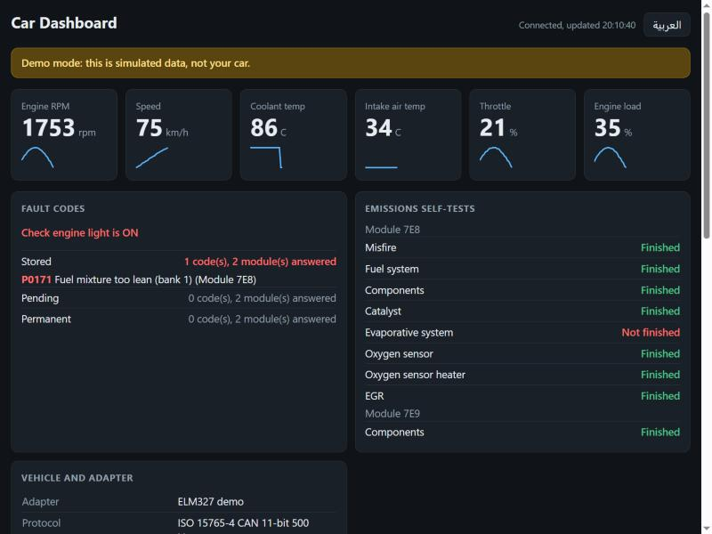
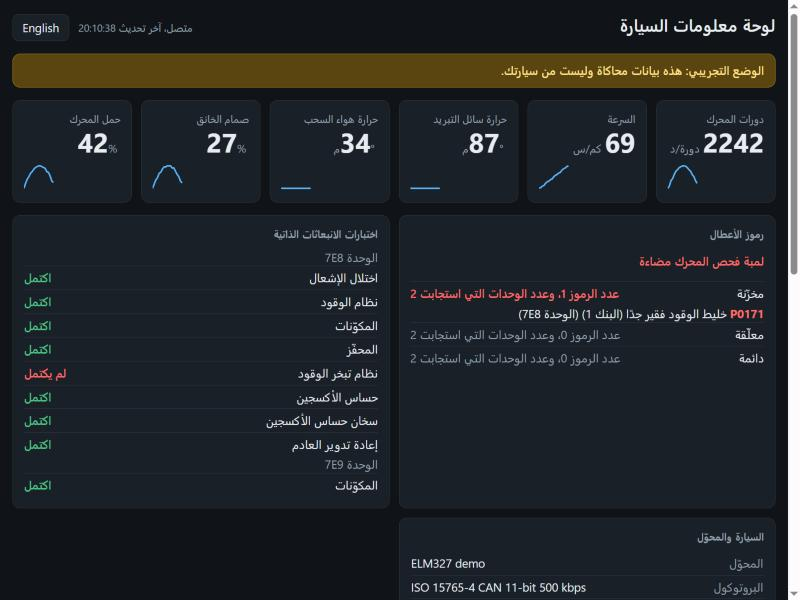

# elmlens

**[English](#english) | [العربية](#العربية)**

---

## English

See what your car is reporting, on a Windows laptop, using a cheap Bluetooth LE ELM327 adapter.

Many ELM327 adapters are Bluetooth LE (BLE). Windows gives them no COM port, so most OBD-II programs can't find them. elmlens talks to the adapter directly over BLE.



*Screenshot from demo mode, so the data is simulated.*

### Features

- **Browser dashboard:** live values, fault codes, self-tests and vehicle details on one page, served only on your laptop
- **Arabic and English:** switch with one button on the dashboard, which also flips the page to right-to-left, or use `--lang`
- **Fault codes:** stored, pending and permanent, with descriptions for about 9,500 generic codes
- **Other modules:** looks for modules beyond the engine and reads their fault codes where the car allows it
- **Many cars:** searchable catalog of about 880 community car profiles, downloaded when you need one
- **Saved cars:** remembers each car that connects, with its details and latest readings, on your laptop only
- **Battery check:** explains the voltage in plain language, using the car's own reading when available
- **Full report and CSV logging:** save a full reading to a text file, or record live values for a spreadsheet
- **Protected clearing:** clearing codes only works with the engine off, and you must type `CLEAR` first

### What you need

- Windows 10 or 11 with Bluetooth
- Python 3.12 (other versions are untested)
- A BLE ELM327 adapter that offers the `FFF0` serial service
- A car that uses 11-bit CAN, which is most cars from about 2008 onward

Classic Bluetooth, USB and Wi-Fi adapters aren't supported.

### Setup

```
git clone https://github.com/alequab/elmlens.git
cd elmlens
python -m venv .venv
.venv\Scripts\python -m pip install -r requirements.txt
```

Then:

1. Plug the adapter into the car's OBD-II port.
2. Start the engine outdoors, or turn the ignition ON.
3. Pair the adapter in Windows Bluetooth settings. If it asks for a PIN, try `1234`, `0000` or `6789`.
4. Turn off Bluetooth on any phone that has connected to the adapter.

### Usage

Run these from the project folder:

| Command | What it does |
|---|---|
| `.\obd dashboard` | Opens everything on one page in your browser, and keeps trying until the car answers |
| `.\obd dashboard --demo` | Shows the dashboard with simulated data, no adapter or car needed |
| `.\obd report` | Reads everything once and saves it in `reports\` |
| `.\obd info` | Adapter, voltage, check engine light and self-tests |
| `.\obd battery` | Battery voltage with a plain-language explanation |
| `.\obd codes` | Stored, pending and permanent fault codes |
| `.\obd scan` | Looks for other modules and reads their fault codes where allowed |
| `.\obd cars` | Lists cars saved on this laptop, no adapter needed |
| `.\obd profiles toyota` | Searches the car profile catalog, no adapter needed |
| `.\obd profile --name kia-picanto --year 2017` | Reads extra values for your car, downloading its profile if needed |
| `.\obd live` | Live values in the terminal |
| `.\obd log` | Live values, saved as CSV in `logs\` |
| `.\obd clear` | Clears fault codes, after asking you to confirm |

Press Ctrl+C to stop `dashboard`, `live` or `log`. The adapter serves one program at a time, so stop the dashboard before running another command.

The dashboard also has a **Commands** page, in English and Arabic, with copy buttons and what each command needs.

**Options**

- `--lang ar` or `--lang en` sets the language and remembers it. It goes before the command, such as `.\obd --lang ar report`.
- `--address AA:BB:CC:DD:EE:FF` picks a specific adapter. It goes before the command. By default, elmlens looks for one with `OBD` or `ELM` in its name.
- `--interval 1` sets the seconds between readings, for `dashboard`, `live` and `log`.
- `--samples 20` stops after 20 readings, for the same commands.
- `--port 9000` sets the dashboard's local port.
- `--no-browser` stops the dashboard opening your browser.
- `.\obd profiles --get toyota-camry` downloads a profile now, so you can use it later without internet.

### Safety

- **Don't use the dashboard while driving.** Use `.\obd log`, or have a passenger watch it.
- **Watch your battery.** With the ignition on and the engine off, the battery drains. Unplug the adapter when you finish, because some adapters keep drawing power.
- **Clearing codes doesn't fix a fault.** It also erases saved fault data and resets the emissions self-tests.
- **Every command except `clear` only reads data.** `scan` and `profile` can only send read requests, and the code refuses anything else.
- **`scan` and `profile` refuse to start below 11.8 V,** because long reads drain the battery.

### Privacy

Reports and saved cars can contain your VIN, and logs record how the car was used. All of them stay on your laptop, and `.gitignore` keeps them out of the repo. Delete a file in `cars\` to forget that car. The dashboard only listens on `127.0.0.1`, so other devices can't open it.

### Limits

- It has been tested on one setup so far: one BLE adapter reporting `ELM327 v2.1` on one car using 500 kbps CAN.
- Most commands cover standard engine and emissions data. On the tested car, only the engine and transmission modules answered `scan`, so ABS, airbag and body faults weren't readable. Results depend on the car.
- Profile values come from community data and may not match your car's exact year, and some may not apply to your car at all.
- `profile` skips commands it can't send safely or doesn't support: those that open a special diagnostic session, and those using 29-bit or extended addressing. Some cars lose a lot of data this way.
- Fault code descriptions cover about 9,500 generic codes. Manufacturer-specific codes show a category and need looking up.
- In Arabic, about 80 common fault codes are translated. Others, and profile value names, stay in English.
- Arabic in the Windows terminal may display poorly, because some terminals don't join letters or support right-to-left text. The dashboard and saved report files are better for reading Arabic.
- The adapter's own voltage reading can be off: on the tested setup it read about 1 V above the car's module.
- Live values update one at a time, so slower ones can take several seconds to refresh.

### Development

Run the offline tests, which don't need a car or adapter:

```
.venv\Scripts\python -m unittest test_obd_tool
```

| File | Purpose |
|---|---|
| `obd_tool.py` | Adapter connection, OBD-II decoding and commands |
| `car_modules.py` | Module scan and car profile decoding |
| `garage.py` | Saved car records |
| `i18n.py` | English and Arabic text |
| `dashboard.py`, `dashboard.html`, `commands.html` | Local web server, dashboard page and Commands page |
| `demo.py` | Simulated adapter for demo mode |
| `dtc_codes.py` | Fault code lookups |
| `profiles\` | Car catalog and the Kia Picanto profile, from OBDb |
| `data\` | Generic fault code descriptions, from OBDex |
| `test_obd_tool.py` | Offline tests |

### License

elmlens is free for **individuals** to use, modify and share for personal purposes. **Companies and organizations may not use it** without written permission, including freelancers and one-person businesses using it for their work. It may not be sold. See [LICENSE](LICENSE) for the full terms.

Because of these limits, elmlens is source-available rather than open source. The third-party components it includes keep their own licenses, listed in [THIRD_PARTY_NOTICES.md](THIRD_PARTY_NOTICES.md).

---

<div dir="rtl" lang="ar">

## العربية

اعرف ما تُبلغ عنه سيارتك من خلال حاسوب محمول يعمل بنظام Windows ومحوّل ELM327 رخيص يعمل بتقنية Bluetooth LE.

كثير من محوّلات ELM327 تعمل بتقنية Bluetooth LE ‏(BLE)، ولا يعطيها Windows منفذ COM، لذلك لا تجدها معظم برامج OBD-II. أما elmlens فيتصل بالمحوّل مباشرة عبر BLE.



*لقطة من الوضع التجريبي، فالبيانات المعروضة محاكاة.*

### المزايا

- **لوحة معلومات في المتصفح:** القيم المباشرة ورموز الأعطال والاختبارات الذاتية وبيانات السيارة في صفحة واحدة، تعمل على جهازك فقط
- **العربية والإنجليزية:** بدّل اللغة بزر واحد في لوحة المعلومات، فتتحول الصفحة أيضًا من اليمين إلى اليسار، أو استخدم `--lang`
- **رموز الأعطال:** المخزّنة والمعلّقة والدائمة، مع أوصاف لنحو 9,500 رمز عام
- **وحدات أخرى:** يبحث عن وحدات غير المحرك ويقرأ رموز أعطالها إذا سمحت السيارة بذلك
- **سيارات كثيرة:** قائمة قابلة للبحث تضم نحو 880 ملف سيارة من المجتمع، تُنزَّل عند الحاجة
- **حفظ السيارات:** يحفظ كل سيارة تتصل به مع بياناتها وآخر قراءاتها، على جهازك فقط
- **فحص البطارية:** يشرح الجهد بلغة بسيطة، ويعتمد على قراءة السيارة نفسها إذا توفرت
- **تقرير كامل وسجل CSV:** احفظ قراءة كاملة في ملف نصي، أو سجّل القيم المباشرة لفتحها في جدول بيانات
- **مسح محميّ:** لا يعمل مسح الرموز إلا والمحرك متوقف، وبعد أن تكتب `CLEAR`

### المتطلبات

- نظام Windows 10 أو 11 مع Bluetooth
- ‏Python 3.12 (الإصدارات الأخرى لم تُختبر)
- محوّل ELM327 يعمل بتقنية BLE ويوفر الخدمة التسلسلية `FFF0`
- سيارة تستخدم CAN بعناوين 11 بت، وهذا حال معظم السيارات منذ نحو عام 2008

المحوّلات التي تعمل بتقنية Bluetooth التقليدية أو USB أو Wi-Fi غير مدعومة.

### التثبيت

<div dir="ltr">

```
git clone https://github.com/alequab/elmlens.git
cd elmlens
python -m venv .venv
.venv\Scripts\python -m pip install -r requirements.txt
```

</div>

ثم:

1. وصّل المحوّل بمنفذ OBD-II في السيارة.
2. شغّل المحرك في مكان مفتوح، أو أدر مفتاح الإشعال.
3. أقرن المحوّل من إعدادات Bluetooth في Windows. إذا طلب رمز PIN فجرّب `1234` أو `0000` أو `6789`.
4. أوقف Bluetooth في أي هاتف اتصل بالمحوّل من قبل.

### الاستخدام

شغّل هذه الأوامر من مجلد المشروع:

| الأمر | ماذا يفعل |
|---|---|
| `.\obd dashboard` | يفتح كل البيانات في صفحة واحدة في المتصفح، ويواصل المحاولة حتى تستجيب السيارة |
| `.\obd dashboard --demo` | يعرض لوحة المعلومات ببيانات محاكاة، دون محوّل أو سيارة |
| `.\obd report` | يقرأ كل البيانات مرة واحدة ويحفظها في مجلد `reports\` |
| `.\obd info` | المحوّل والجهد ولمبة فحص المحرك والاختبارات الذاتية |
| `.\obd battery` | جهد البطارية مع شرح بلغة بسيطة |
| `.\obd codes` | رموز الأعطال المخزّنة والمعلّقة والدائمة |
| `.\obd scan` | يبحث عن وحدات أخرى ويقرأ رموز أعطالها إذا سُمح بذلك |
| `.\obd cars` | يعرض السيارات المحفوظة على هذا الجهاز، دون محوّل |
| `.\obd profiles toyota` | يبحث في قائمة ملفات السيارات، دون محوّل |
| `.\obd profile --name kia-picanto --year 2017` | يقرأ قيمًا إضافية لسيارتك، وينزّل ملفها عند الحاجة |
| `.\obd live` | القيم المباشرة في الطرفية |
| `.\obd log` | القيم المباشرة مع حفظها بصيغة CSV في مجلد `logs\` |
| `.\obd clear` | يمسح رموز الأعطال بعد أن يطلب منك التأكيد |

اضغط Ctrl+C لإيقاف `dashboard` أو `live` أو `log`. يخدم المحوّل برنامجًا واحدًا في كل مرة، لذلك أوقف لوحة المعلومات قبل تشغيل أمر آخر.

تحتوي لوحة المعلومات أيضًا على صفحة **الأوامر**، بالعربية والإنجليزية، مع أزرار نسخ وبيان ما يتطلبه كل أمر.

**الخيارات**

- ‏`--lang ar` أو `--lang en` يحدد اللغة ويحفظها، ويُكتب قبل الأمر، مثل `.\obd --lang ar report`.
- ‏`--address AA:BB:CC:DD:EE:FF` يختار محوّلًا محددًا، ويُكتب قبل الأمر. يبحث elmlens افتراضيًا عن محوّل يحتوي اسمه على `OBD` أو `ELM`.
- ‏`--interval 1` يحدد عدد الثواني بين القراءات، للأوامر `dashboard` و`live` و`log`.
- ‏`--samples 20` يوقف البرنامج بعد 20 قراءة، للأوامر نفسها.
- ‏`--port 9000` يحدد المنفذ المحلي للوحة المعلومات.
- ‏`--no-browser` يمنع فتح المتصفح تلقائيًا مع لوحة المعلومات.
- ‏`.\obd profiles --get toyota-camry` ينزّل ملف السيارة الآن لتستخدمه لاحقًا دون إنترنت.

### السلامة

- **لا تستخدم لوحة المعلومات أثناء القيادة.** استخدم `.\obd log`، أو اجعل أحد الركاب يتابعها.
- **انتبه إلى البطارية.** تُستنزف البطارية عندما يكون الإشعال يعمل والمحرك متوقفًا. افصل المحوّل عند الانتهاء، لأن بعض المحوّلات تواصل سحب الكهرباء.
- **مسح الرموز لا يصلح العطل.** وهو يمحو أيضًا بيانات الأعطال المحفوظة ويعيد ضبط اختبارات الانبعاثات الذاتية.
- **كل الأوامر ما عدا `clear` تقرأ البيانات فقط.** لا يرسل `scan` و`profile` إلا طلبات قراءة، ويرفض البرنامج ما سواها.
- **لا يبدأ `scan` و`profile` إذا كان الجهد أقل من 11.8 فولت،** لأن القراءات الطويلة تستنزف البطارية.

### الخصوصية

قد تحتوي التقارير والسيارات المحفوظة على رقم الهيكل (VIN)، وتسجّل ملفات السجل طريقة استخدام السيارة. كل ذلك يبقى على جهازك، ويمنع ملف `.gitignore` رفعه إلى المستودع. احذف ملف السيارة من مجلد `cars\` إذا أردت نسيانها. تعمل لوحة المعلومات على العنوان `127.0.0.1` فقط، فلا تستطيع الأجهزة الأخرى فتحها.

### الحدود

- اختُبر البرنامج حتى الآن على إعداد واحد: محوّل BLE واحد يعرّف نفسه بأنه `ELM327 v2.1` مع سيارة واحدة تستخدم CAN بسرعة 500 kbps.
- تغطي معظم الأوامر بيانات المحرك والانبعاثات القياسية. في السيارة التي اختُبر عليها، لم تستجب للأمر `scan` إلا وحدتا المحرك وناقل الحركة، فلم تُقرأ أعطال ABS والوسائد الهوائية والهيكل. وتختلف النتائج من سيارة إلى أخرى.
- قيم ملفات السيارات مصدرها بيانات المجتمع، وقد لا تطابق سنة سيارتك بالضبط، وقد لا ينطبق بعضها على سيارتك أصلًا.
- يتخطى `profile` الأوامر التي لا يستطيع إرسالها بأمان أو لا يدعمها: وهي التي تفتح جلسة تشخيص خاصة، والتي تستخدم عناوين 29 بت أو العناوين الموسّعة. وقد تفقد بعض السيارات كثيرًا من البيانات بسبب ذلك.
- تغطي أوصاف رموز الأعطال نحو 9,500 رمز عام. أما الرموز الخاصة بالشركات المصنّعة فيظهر تصنيفها فقط وتحتاج إلى بحث.
- في العربية تُرجم نحو 80 رمز عطل شائعًا، وتبقى الرموز الأخرى وأسماء قيم ملفات السيارات بالإنجليزية.
- قد تظهر العربية بشكل سيئ في طرفية Windows، لأن بعض الطرفيات لا تصل الحروف ولا تدعم الكتابة من اليمين إلى اليسار. لوحة المعلومات وملفات التقارير أفضل لقراءة العربية.
- قد تكون قراءة الجهد من المحوّل غير دقيقة: ففي الإعداد الذي جرى اختباره كانت أعلى بنحو 1 فولت من قراءة وحدة السيارة.
- تُحدَّث القيم المباشرة واحدة تلو الأخرى، لذلك قد يستغرق تحديث القيم الأبطأ عدة ثوانٍ.

### التطوير

شغّل الاختبارات التي لا تحتاج إلى سيارة أو محوّل:

<div dir="ltr">

```
.venv\Scripts\python -m unittest test_obd_tool
```

</div>

| الملف | وظيفته |
|---|---|
| `obd_tool.py` | الاتصال بالمحوّل وتفسير بيانات OBD-II والأوامر |
| `car_modules.py` | البحث عن الوحدات وتفسير ملفات السيارات |
| `garage.py` | سجلات السيارات المحفوظة |
| `i18n.py` | النصوص العربية والإنجليزية |
| `dashboard.py` و`dashboard.html` و`commands.html` | الخادم المحلي وصفحة لوحة المعلومات وصفحة الأوامر |
| `demo.py` | محوّل محاكاة للوضع التجريبي |
| `dtc_codes.py` | البحث عن أوصاف رموز الأعطال |
| `profiles\` | قائمة السيارات وملف Kia Picanto، من OBDb |
| `data\` | أوصاف رموز الأعطال العامة، من OBDex |
| `test_obd_tool.py` | الاختبارات |

### الترخيص

يمكن **للأفراد** استخدام elmlens وتعديله ومشاركته مجانًا للأغراض الشخصية. **ولا يحق للشركات والمؤسسات استخدامه** بدون إذن كتابي، ويشمل ذلك العاملين لحسابهم الخاص والأعمال الفردية عند استخدامه في عملهم. ولا يجوز بيعه. راجع ملف [LICENSE](LICENSE) للاطلاع على الشروط كاملة، والنص الإنجليزي هو المعتمد.

بسبب هذه القيود، يُعد elmlens مشروعًا متاح الشيفرة للاطلاع (source-available) وليس مفتوح المصدر بالمعنى المعروف. وتبقى المكونات الخارجية المضمنة فيه خاضعة لرخصها الخاصة، وهي مذكورة في [THIRD_PARTY_NOTICES.md](THIRD_PARTY_NOTICES.md).

</div>
